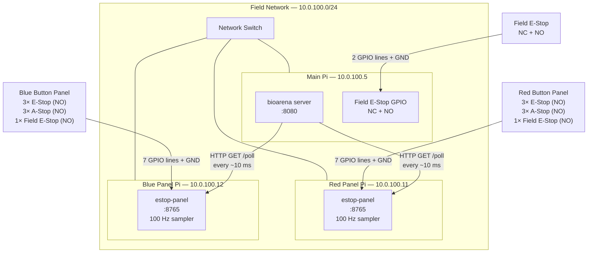
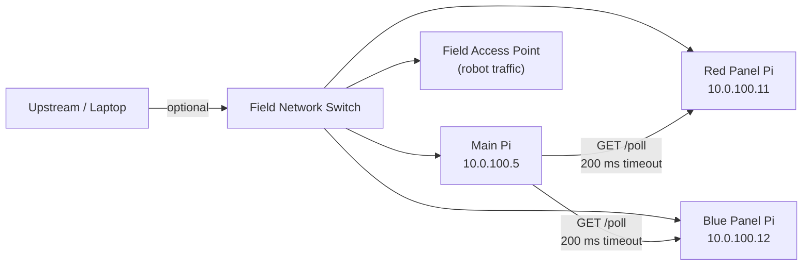
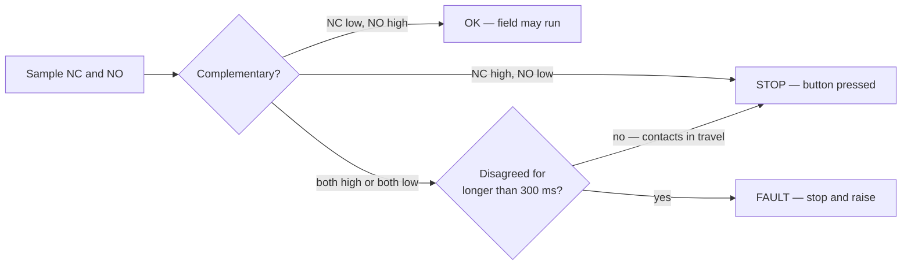
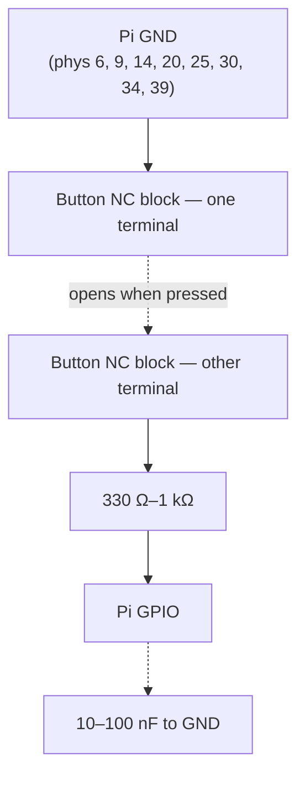
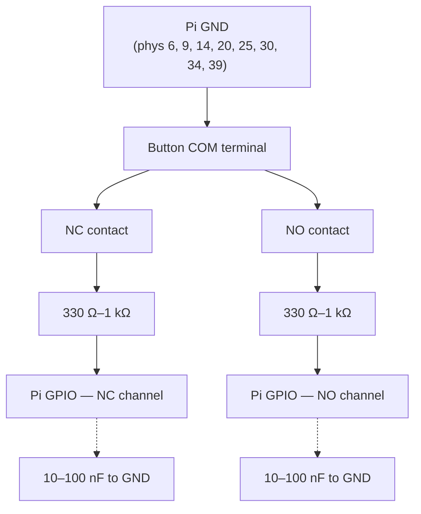
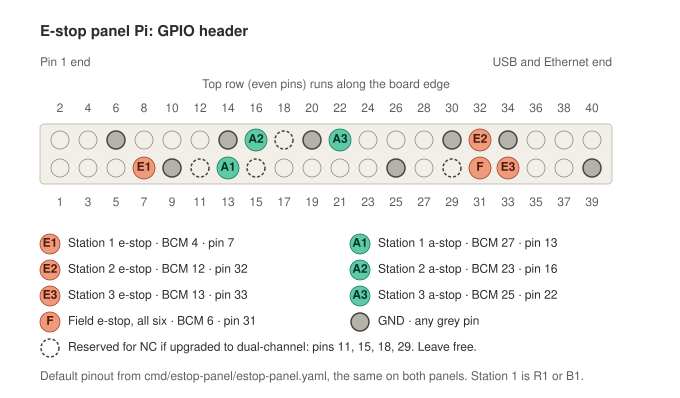
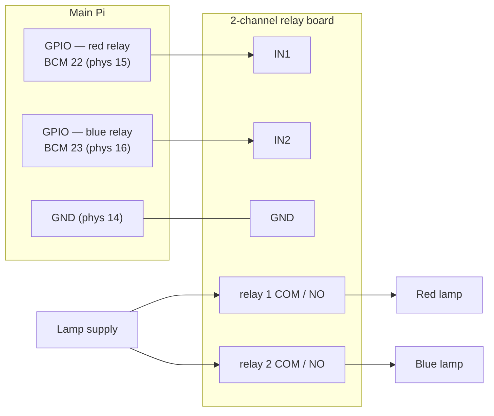
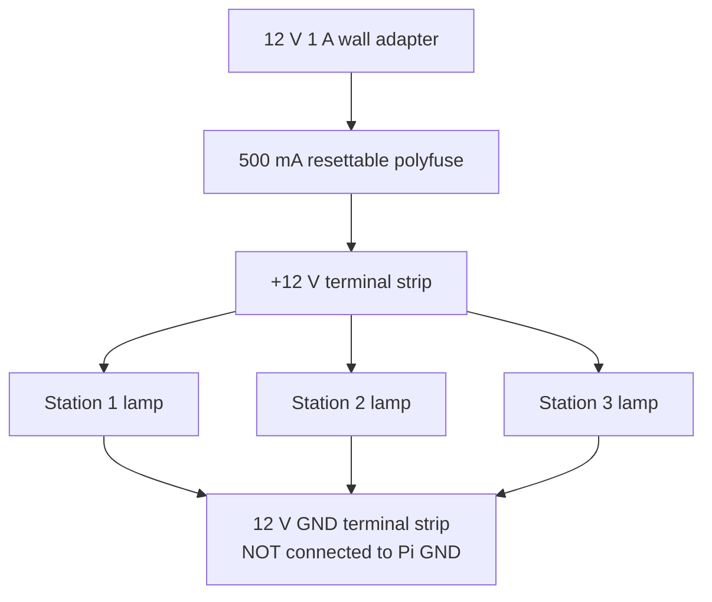

# Hardware Wiring Guide

This guide walks a first-time builder through wiring all field hardware: the main Pi, one panel Pi per alliance, and the button panels.

Panel buttons are wired as a **single normally-closed (NC) contact** by default: two conductors per button, GND and NC, e-stops and a-stops alike. The main Pi's field e-stop is wired **dual-channel** — NC and NO on separate conductors — so the field can tell a released button from broken wiring, and any panel e-stop can be upgraded to the same later by adding its NO conductor, without moving anything already wired.

> **Why NC and not NO.** A single contact cannot tell a pressed button from broken wiring, so it matters which way it errs. A cut conductor, a loose terminal or an unplugged cable reads HIGH. On an NC contact that is a pressed button: the station stops and stays stopped until the wiring is fixed. On an NO contact it would be a released one, and that button would silently do nothing. Press every button before each session anyway — see [section 12](#12-test-procedure).

---

## Contents

1. [System Overview](#1-system-overview)
2. [Bill of Materials](#2-bill-of-materials)
3. [Network Topology](#3-network-topology)
4. [How Dual-Channel Detection Works](#4-how-dual-channel-detection-works)
5. [Single Button Circuit](#5-single-button-circuit)
6. [Wiring an E-Stop Panel Pi](#6-wiring-an-e-stop-panel-pi)
7. [Main Pi Field E-Stop](#7-main-pi-field-e-stop)
8. [Main Pi Hub Relays](#8-main-pi-hub-relays)
9. [Power and Indicator Lamps](#9-power-and-indicator-lamps)
10. [Physical Panel Layout](#10-physical-panel-layout)
11. [Software Configuration](#11-software-configuration)
12. [Test Procedure](#12-test-procedure)
13. [Troubleshooting](#13-troubleshooting)

---

## 1. System Overview

Three Raspberry Pis connect through a network switch. The two panel Pis each handle one alliance's buttons; the main Pi polls them over HTTP and runs the arena server.



Two properties of this design are worth understanding before you cut any wire:

- **On a dual-channel e-stop, a wiring fault stops the field.** If the two channels disagree in a way that healthy wiring cannot produce, the arena treats that station as stopped and refuses to start a match until it clears. A single-NO e-stop has no second channel to disagree with, so its wiring faults go unseen.
- **An unreachable panel Pi is a fault, not silence.** A panel that loses power or drops off the switch reports as faulted on all three of its stations. Do not configure a panel address you are not going to keep running.

---

## 2. Bill of Materials

One set of this list covers both alliances plus the main Pi field e-stop.
Quantities marked with **×2** mean one per alliance.

| Qty | Item | Specification | Notes |
|-----|------|---------------|-------|
| 3 | Raspberry Pi 4B (or 3B+) | Any model with Ethernet | 1 main + 2 panel Pis |
| **×2** | 3× latching mushroom e-stop button | 22 mm, **NC contact block**, separate lamp terminals | Only the NC block is wired. Buy buttons with an NO block too if you may ever upgrade to dual-channel |
| **×2** | 1× latching mushroom e-stop button | 22 mm, NC contact block | Field-wide e-stop on each panel (`field_estop`) — optional |
| **×2** | 3× momentary pushbutton (A-stop) | 16–22 mm, NC contact | Any colour; these are not latching |
| 1 | Latching mushroom e-stop button | 22 mm, NC + NO contact blocks | Field-wide e-stop on the main Pi |
| As needed | 330 Ω–1 kΩ resistors (1/4 W) | ±5% or better | One per GPIO line, in series at the Pi end |
| As needed | 10 nF–100 nF ceramic capacitors | 50 V | One per GPIO line to GND at the Pi end; debounce and ESD |
| As needed | 10 kΩ resistors (1/4 W) | ±5% or better | Optional external pull-up per line; recommended for runs over ~2 m |
| As needed | 22 AWG 2-conductor cable | Rated ≥ 24 V | One run per button: GND and NO. Use 3-conductor (GND, NC, NO) for a dual-channel button, or to leave room to upgrade one. Shielded or twisted improves noise immunity |
| **×2** | 12 V 1 A regulated power adapter | 2.1 mm barrel connector | **Lamps only** — see [section 9](#9-power-and-indicator-lamps). Omit if your buttons are unlit |
| **×2** | 500 mA resettable polyfuse (PTC) | Rated ≥ 15 V | Inline on the +12 V lamp feed |
| **×2** | DIN rail section, ~20 cm | 35 mm standard | Mounts inside enclosure |
| **×2** | Small enclosure, ~150×100×60 mm | IP54 or better | Holds Pi and terminal strips |
| **×2** | 2× terminal block strip | 10-position | GND bus and NO bus per panel; a third for an NC bus if any button goes dual-channel |
| As needed | Ferrule crimp terminals | 22 AWG | Clean screw-terminal connections; highly recommended |
| As needed | Wire labels / heat-shrink label sleeves | — | Label every conductor at both ends, including which channel it is |

> **What is no longer needed:** earlier revisions of this field used 12 V button loops through opto-isolation boards. The current wiring runs the sense contacts directly to the Pi at 3.3 V instead. If you are rebuilding an existing panel, the opto boards come out and the 12 V loop shrinks to the lamp circuit only.

---

## 3. Network Topology

All three Pis sit on the same 10.0.100.0/24 subnet, connected through the field switch. No special VLANs are needed for the e-stop traffic; the main Pi polls each panel Pi over plain HTTP.



Static IPs are set by the systemd service files (see [Software Configuration](#11-software-configuration)).

---

## 4. How Dual-Channel Detection Works

This applies to the main Pi's field e-stop, and to any panel e-stop whose NO contact is wired as well. A single NC contact — the panel default — reads only one line:

| NC line | Meaning | Field response |
|---------|---------|----------------|
| LOW | Released | OK |
| HIGH | Pressed — **or a cut conductor, broken ground, or unplugged cable** | **STOP** |

The second row is the trade: broken wiring stops the station, which is safe, but reads as a press rather than as a fault, so nothing says the wiring is to blame. The rest of this section is what a second contact buys back.

Each dual-channel e-stop button carries two contact blocks that move together but wire separately:

- The **NC (normally closed)** contact is closed when the button is released and opens when it is pressed.
- The **NO (normally open)** contact does the opposite.

Both GPIO lines use the Pi's internal pull-up, so an open contact reads HIGH and a closed contact pulls its line to GND and reads LOW. In healthy operation the two readings are always opposites. Anything else is the wiring telling you something.

| NC line | NO line | Meaning | Field response |
|---------|---------|---------|----------------|
| LOW | HIGH | Released, both channels agree | **OK** |
| HIGH | LOW | Pressed, both channels agree | **STOP** |
| HIGH | HIGH | Both contacts open — cut conductor, broken common ground, or unplugged cable | **FAULT** → stop |
| LOW | LOW | Both contacts closed — shorted conductors or a welded contact | **FAULT** → stop |



**Why the NC contact matters most.** It is closed during normal operation, which means current is flowing through it whenever the field is running. Cut that conductor, unplug the cable, or break the shared ground, and the line floats up to the pull-up and reads HIGH — the same as a pressed button. The failure direction is toward detection rather than toward a false OK. A single-channel NO button gives you the opposite: a cut wire looks exactly like a healthy released button, forever.

**Why there is a 300 ms window.** A mushroom button's contacts do not switch at the same instant — there is a few milliseconds of travel where both are open. Without a discrepancy window, every legitimate press would log a wiring fault. The field stops immediately on the first ambiguous reading; only the *classification* waits for the window to expire. Nothing about this delays a stop.

**What this cannot catch.** A fault that exactly mimics complementary behaviour is invisible — but every single-conductor failure, the common-ground failure, and a cross-short between the two sense lines all land in one of the two fault rows above.

---

## 5. Single Button Circuit

### Single NC contact — every panel button, e-stops and a-stops

Two conductors per button: common GND and NC. Use the button's **NC** contact block — usually marked 1–2 or 11–12 — and leave any NO block (3–4, 13–14) unconnected.



Released, the contact is closed and holds the GPIO LOW. Pressed, it opens and the Pi's pull-up takes the line HIGH. A latching mushroom holds it there until it is twisted out. The resistor and capacitor are optional — see below.

A single NO contact works too, as `{no: N}` in the configuration: open at rest, LOW when pressed. It is the opposite failure, a cut wire reading as released, which is why it is not the default.

### Dual-channel — the main Pi's field e-stop, or an upgraded panel e-stop

Three conductors run to each e-stop: common GND, NC, and NO.



The series resistor limits current if a sense line ever meets 5 V or 12 V through a wiring mistake; the capacitor gives you debounce and a little ESD headroom for free. Neither changes the logic — the internal pull-up is roughly 50 kΩ, so a 1 kΩ series resistor still pulls the line convincingly low through a closed contact.

For cable runs over about 2 m, add a 10 kΩ external pull-up from each sense line to 3.3 V. The internal pull-up is weak enough that long unshielded runs start picking up noise.

> **Do not connect the sense circuit to 12 V.** If your buttons have illuminated lamps, the lamp circuit is a completely separate loop — see [section 9](#9-power-and-indicator-lamps).

---

## 6. Wiring an E-Stop Panel Pi

Each panel Pi uses 7 GPIO lines — one per button — plus shared grounds. The pins below avoid I2C (2, 3), UART (14, 15), the HAT EEPROM (0, 1), the I2S block (18–21), and SPI0 (7–11), so those buses stay available. They are what the panel's default configuration expects, so nothing needs to be set in software.

### GPIO pin reference

| Button | Config key | GPIO — BCM (phys) | NO pin, if upgraded later |
|--------|------------|-------------------|---------------------------|
| Station 1 E-Stop | `station1_estop` | 4 (7) | 17 (11) |
| Station 1 A-Stop | `station1_astop` | 27 (13) | — |
| Station 2 E-Stop | `station2_estop` | 12 (32) | 22 (15) |
| Station 2 A-Stop | `station2_astop` | 23 (16) | — |
| Station 3 E-Stop | `station3_estop` | 13 (33) | 24 (18) |
| Station 3 A-Stop | `station3_astop` | 25 (22) | — |
| Field E-Stop (panel) | `field_estop` | 6 (31) | 5 (29) |
| Common GND | — | phys 6, 9, 14, 20, 25, 30, 34, 39 | — |



Station 1 is R1 on the red panel and B1 on the blue one; the field e-stop on either panel stops all six stations. A configured button that is not fitted reads as pressed, because its pin floats up to the pull-up — the same as one fitted and come loose, which is the point. The panel field e-stop is the exception: it is optional and stops all six stations, so the field controller ignores it unless that panel is ticked as having one, under **Arena → Settings → Field → E-Stop Panels**. The panel reads pin 31 either way; fitting the button is just the tick.

The last column is reserved, not wired: leave those pins free and an e-stop can go dual-channel later by wiring its NO contact there and adding a `no:` pin to its configuration, with nothing else moving. BCM 16 and 26 are left free as well.

### Step-by-step wiring

1. Run the **GND bus** from any Pi GND pin to the terminal strip, then to one terminal of every button's NC contact block. All buttons share this ground.
2. Run the **other terminal** of each button's NC block to its own position on the terminal strip, then to its GPIO pin from the table, through a series resistor if you are fitting them.
3. Fit the optional capacitor from each GPIO pin to GND, as close to the Pi header as you can manage.
4. Do **not** add pull-down resistors anywhere. The internal pull-ups are what make the active-low logic work.

> **Use the NC block, not the NO.** On an NO block the logic inverts: a released button reads as pressed and the station stays stopped, while pressing it clears the stop. The press test in [section 12](#12-test-procedure) catches it at once.

> **Label every conductor at both ends** with its station and button — `R1-ESTOP`, `R1-ASTOP`. With one conductor per button, a swap between two stations is the easiest mistake to make and the hardest to see: the wrong station stops.

---

## 7. Main Pi Field E-Stop

The main bioarena server monitors two local GPIO pins for a field-wide e-stop, wired exactly like the panel e-stops in [section 5](#5-single-button-circuit).

Configure both pins in **Setup → Settings**:

- **Field E-Stop NO GPIO Pin** — recommended **BCM 21** (physical pin 40)
- **Field E-Stop NC GPIO Pin** — recommended **BCM 26** (physical pin 37)

With GND on physical pin 39, all three conductors land in the same header corner. Leaving the NC pin at 0 falls back to single-channel monitoring with no fault detection; setting the NO pin to 0 disables field e-stop monitoring entirely.

BCM 21 is also PCM_DOUT. That only matters if this Pi ever gets an I2S audio HAT, which would claim GPIO 18–21 through its device-tree overlay and take the pin out from under the arena at boot. If a DAC HAT is in this Pi's future, use BCM 16 and 26 instead.

The field e-stop **latches**: once triggered it stays triggered until an operator clears it from the web UI, and the clear is refused while the button is still held or the wiring is still faulted.

---

## 8. Main Pi Hub Relays

The alternative to DMX Hub lighting: one relay per HUB, each switching a plain red or blue lamp, driven from two GPIO pins on the main Pi. Select **Relays** as the output under **Setup → Settings → LEDs**; the lamp for a HUB is on while that HUB is active and off while it is not, and blinks for the warning before it goes inactive and, during the transition shift, to mark the HUB that goes inactive first.

**Relay wear.** Blinking costs up to about twenty on/off cycles per relay per match. That is nothing to a relay switching lamp-sized loads, but a solid-state relay board has no contacts to wear at all and drops in the same way.



The relays switch the lamps' own supply through their COM and NO contacts. Lamp current never goes near the Pi.

**Pins.** BCM 22 and 23 by default, changeable in Settings and kept across restarts. Those two sit in BCM 9–27, which the Pi pulls *down* from power-on until bioarena claims them, so a board that switches on HIGH stays dark while the Pi boots. The settings page refuses a pin shared between the two relays or with the field e-stop.

**Active-low boards.** Most opto-isolated relay modules click on when their input is pulled LOW. Tick **Relays switch on when LOW** for one of those. Two things change with it:

- The default pins would light both lamps from power-on until bioarena starts, since they boot pulled down. Move to pins that boot pulled *up*: **BCM 7 (phys 26)** and **BCM 8 (phys 24)**, with GND on phys 25. They are the SPI0 chip selects, free unless SPI is enabled on this Pi.
- Many of these modules expect 5 V logic, and on some a 3.3 V "off" still lets enough current through the opto LED to hold the relay in. If the board has a **JD-VCC** jumper, remove it, feed **JD-VCC** from 5 V for the coils and **VCC** from the Pi's 3.3 V for the inputs.

To click a relay by hand, stop the service first, since the kernel gives a line to one requester:

```bash
sudo systemctl stop bioarena
gpioset --mode=time --sec=2 gpiochip0 22=1
sudo systemctl start bioarena
```

Use `22=0` on an active-low board.

---

## 9. Power and Indicator Lamps

The sense circuit needs no power supply of its own — it runs on the Pi's 3.3 V pull-ups.

If your mushroom buttons have illuminated lamps, wire them as an independent 12 V loop that shares nothing with the sense conductors:



Keep the 12 V return separate from the Pi GND bus. The lamps are decoration; the sense contacts are the safety path, and nothing about the lamp circuit should be able to influence them.

Run each Pi from its own USB-C supply (≥ 3 A for a Pi 4).

---

## 10. Physical Panel Layout

A typical alliance button panel has three driver stations across a table edge. Suggested layout:

```
┌──────────────┬──────────────┬──────────────┐
│  Station 1   │  Station 2   │  Station 3   │
│              │              │              │
│  [E-STOP]    │  [E-STOP]    │  [E-STOP]    │
│  (mushroom)  │  (mushroom)  │  (mushroom)  │
│              │              │              │
│  [A-STOP]    │  [A-STOP]    │  [A-STOP]    │
│  (pushbtn)   │  (pushbtn)   │  (pushbtn)   │
└──────────────┴──────────────┴──────────────┘
```

- Mount the Pi and terminal strips inside a small enclosure behind or beneath the panel.
- Route button wires through a cable clamp at the panel edge for strain relief.
- Keep the sense runs away from the 12 V lamp wiring where you can.
- Use consistent colours per channel across the whole field — e.g. black GND, white NC, blue NO.

---

## 11. Software Configuration

### Panel Pi: `estop-panel.yaml`

Nothing to write by hand. `deploy-panel.sh` installs [`cmd/estop-panel/estop-panel.yaml`](../cmd/estop-panel/estop-panel.yaml) on a panel that has no configuration yet, with the alliance from its argument written in: every input a single NC contact, on the pins in [section 6](#6-wiring-an-e-stop-panel-pi). A panel that already has a configuration keeps it, so a change made on the panel survives a redeploy.

To upgrade an e-stop to dual-channel, wire its NO contact to the reserved pin, then edit `/opt/estop-panel/estop-panel.yaml` on the panel and restart the service:

```yaml
pins:
  station1_estop: {nc: 4, no: 17}   # was: {nc: 4}
```

`{nc: N}` is a single NC contact, `{no: N}` or a bare `N` a single NO contact, and `0` means the input is not wired and is skipped.

A panel deployed before the NC default carries a configuration of bare numbers — single NO — and a redeploy keeps it. If its buttons are wired NC, every input reads inverted; delete `/opt/estop-panel/estop-panel.yaml` on the panel and redeploy to get the current default.

### Static IP (set in the systemd service file)

`deploy-panel.sh` writes it from the alliance argument — `10.0.100.11` red, `10.0.100.12` blue — so there is nothing to edit. It lands on the `ExecStartPre` line of `estop-panel.service`:

```ini
ExecStartPre=/sbin/ip addr add 10.0.100.11/24 dev eth0   # red panel
```

### Main Pi: `config.yaml`

Uncomment and fill in the panel addresses:

```yaml
red_estop_panel:
  host: "http://10.0.100.11:8765"
blue_estop_panel:
  host: "http://10.0.100.12:8765"
```

Addresses can also be changed live in **Setup → Settings** without restarting bioarena. Remember that a configured-but-absent panel faults its stations — clear the address if you are running without that panel.

### Deploy the panel binary

Run on your development machine:

```bash
./build-pi.sh
```

Then deploy to each panel Pi, giving the alliance:

```bash
./deploy-panel.sh <PANEL_ADDRESS> red
```

`<PANEL_ADDRESS>` is wherever that Pi answers from your development machine — normally a
bench network the two share, not the field. The alliance is the separate thing that writes
the static field address (`10.0.100.11` red, `10.0.100.12` blue) into the service file.

See [README.md](../README.md) for the full deployment steps, including the service account and systemd unit.

---

## 12. Test Procedure

Work through this checklist before using the system for a match. The fault-injection steps matter as much as the button steps — dual-channel wiring you have never seen fault is dual-channel wiring you have not tested.

### Power-up checks

- [ ] Panel Pi boots and the `estop-panel` service is running:
  ```bash
  systemctl status estop-panel
  ```
- [ ] Health endpoint is green (it returns 503 while any input is faulted):
  ```bash
  curl -i http://10.0.100.11:8765/health
  ```
- [ ] If lamps are fitted: 12 V rail measures 11.5–12.5 V, and its return has **no continuity** to any Pi GND pin.

### Per-button checks (one button at a time)

For each e-stop:

1. With the button released, poll the panel:
   ```bash
   curl http://10.0.100.11:8765/poll
   ```
   The station's e-stop entry should read `"state":0` (OK) with `"fault":0`.
2. Latch the button. The same entry should read `"state":1` (stopped), still `"fault":0`,
   and **the right station** should show stopped on Match Play. For a dual-channel e-stop, a
   `"state":2` here means the two channels disagree — check for swapped NC/NO conductors.
3. Reset the button and confirm it returns to `"state":0`.

For a single-contact e-stop this press test is the only check that the right button stops
the right station, so do it for every button before every session, not just at
installation.

For each a-stop, repeat steps 1–3; a-stops only ever report state 0 or 1.

### Fault injection

For a single-NC button, see what a fault looks like once, so it is recognised later:

- [ ] **Pull the NC conductor** at the terminal strip. The input reads `"state":1` and the station stops, exactly as if the button were pressed. That is the fail-safe direction, but nothing says the wiring is to blame; reconnect it and the stop clears.

For the main Pi field e-stop, and any panel e-stop wired dual-channel:

- [ ] **Pull the NC conductor** at the terminal strip. Within ~300 ms the input should report `"state":2` with `"fault":1` (both channels open), and the arena UI should show FAULT for that station.
- [ ] Reconnect it and confirm the fault clears on its own.
- [ ] **Pull the common GND conductor.** Both channels float; the input should fault the same way. This is the failure a single-channel panel cannot see at all.
- [ ] **Short the NC and NO conductors together.** With the button released this should report `"fault":2` (both channels closed).
- [ ] Confirm that during each of the above, **Start Match is refused** with an error naming the station and the fault.

### Panel-loss check

- [ ] Unplug the red panel Pi's Ethernet cable. Within a poll cycle the arena should show all three red stations faulted, and match start should be refused.
- [ ] Reconnect and confirm the fault clears without restarting bioarena.

### Integration checks (main Pi)

- [ ] Open the bioarena web UI at `http://10.0.100.5:8080`.
- [ ] Go to **Setup → Settings** and verify panel addresses and both field e-stop pins are saved.
- [ ] Press an e-stop; the arena UI should show the station stopped immediately.
- [ ] Press the field e-stop mid-match; the match should abort and the overlay should appear.
- [ ] Release the field e-stop and clear it from the UI; verify normal operation resumes.
- [ ] With the field e-stop wiring faulted, confirm the **Clear** button refuses to clear it.

---

## 13. Troubleshooting

| Symptom | Likely cause | Fix |
|---------|-------------|-----|
| A station stays stopped with the button released | Single-NC wiring open somewhere: broken conductor, loose terminal, the wrong GPIO pin, or a button configured but not fitted | Check continuity from the NC terminal to its GPIO pin and from the other terminal to Pi GND; confirm the pin against [section 6](#6-wiring-an-e-stop-panel-pi). An input with no button needs `0` in the configuration |
| Every station stopped at once | A panel ticked as having a field e-stop with no button fitted, or a configured panel that is not answering | Untick **Has a Field E-Stop** for a panel without the button; clear the address of a panel that is not installed, both under Arena → Settings → Field |
| Released reads stopped and pressed reads clear | The configuration and the contact block disagree: NO block wired on an NC configuration, or the other way round | Move the conductor to the NC block, or fix the configuration to match. A panel deployed before the NC default still has a single-NO configuration |
| Pressing an e-stop does nothing; it stays `state:0` | On an NC configuration, the pin is held LOW by something other than the button: the conductor shorted to ground, or landed on a GND terminal | Trace the conductor; it should only reach ground through the closed contact |
| The wrong station stops | Two stations' conductors swapped at the terminal strip | Swap them back; label both ends |
| Input always reports `state:2`, `fault:1` (both open) | A conductor is broken, unplugged, or landed on the wrong terminal; or the common GND is missing | Check continuity from the button COM terminal to Pi GND, then each contact to its GPIO pin |
| Input always reports `state:2`, `fault:2` (both closed) | NC and NO conductors shorted together, or a contact block is welded | Separate the conductors; replace the contact block if it does not open |
| Input reads OK both pressed and released | NC and NO conductors swapped at the terminal strip | Swap them back; the truth table in [section 4](#4-how-dual-channel-detection-works) has the correct polarity |
| Input reads stopped both pressed and released | Same swap, on a button whose contacts are reversed | As above; verify with a multimeter which block opens on press |
| Fault appears briefly on every press, then clears | Contact travel is exceeding the 300 ms discrepancy window | Check for a sticky or misaligned mushroom head; a healthy button transits in a few ms |
| Occasional faults on a long cable run | Noise on a weakly pulled-up line | Add the 10 kΩ external pull-ups and the 10–100 nF capacitors from [section 5](#5-single-button-circuit) |
| All three stations of one alliance faulted at once | The panel Pi is unreachable, or its sampler has stalled | `curl http://10.0.100.11:8765/health`; check `systemctl status estop-panel` and switch cabling |
| Arena logs "panel data stale" | The panel's HTTP server is answering but its sampler is not running | Restart the service; check the journal for GPIO read errors |
| `/poll` returns no inputs | No pins configured, or the wrong `gpio_chip` | Check `estop-panel.yaml`; `gpio_chip` should be `gpiochip0` |
| Field e-stop will not clear from the UI | The button is still latched, or its wiring is still faulted | Twist and pull the mushroom fully; check the overlay for a wiring fault line |
| Panel Pi not reachable over network | Static IP not applied; service failed to start | Check `systemctl status estop-panel`; verify IP with `ip addr show eth0` |

Reading raw pin values on a panel Pi, with the service stopped so it is not holding the lines:

```bash
gpioget -B pull-up gpiochip0 4 27 12 23 13 25 6
```

With every button released, that prints `0` for every fitted button, in the order of the table in [section 6](#6-wiring-an-e-stop-panel-pi); a pressed button, or a broken wire, reads `1` in its position. Pin 6 reads `1` with no field e-stop fitted, which is expected: the field controller ignores it unless the panel is ticked as having one. The `-B pull-up` matters: pins BCM 9–27 power up with an internal pull-*down*, so a line read without it reads 0 regardless of what is connected. For a dual-channel e-stop, read its NC pin too — `gpioget -B pull-up gpiochip0 17 4` prints `0 1` released.

---

*See [README.md](../README.md) for software installation and build instructions.*
